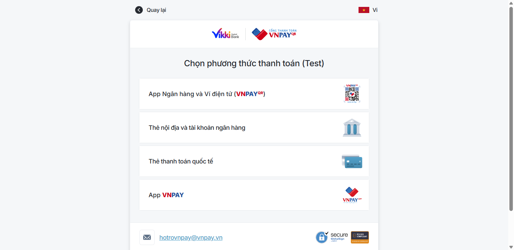
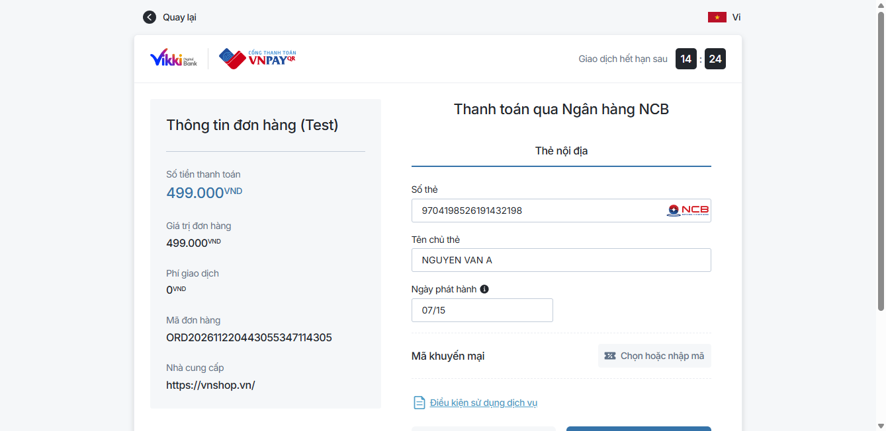
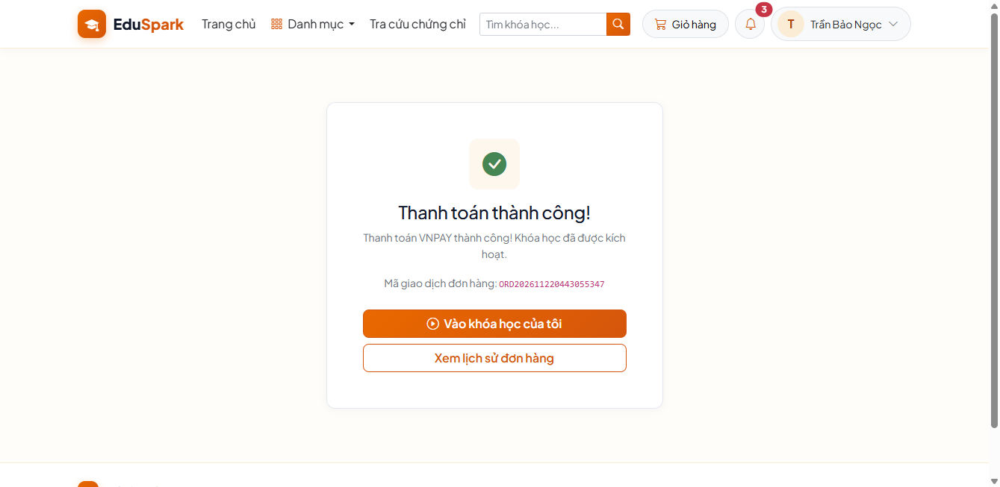
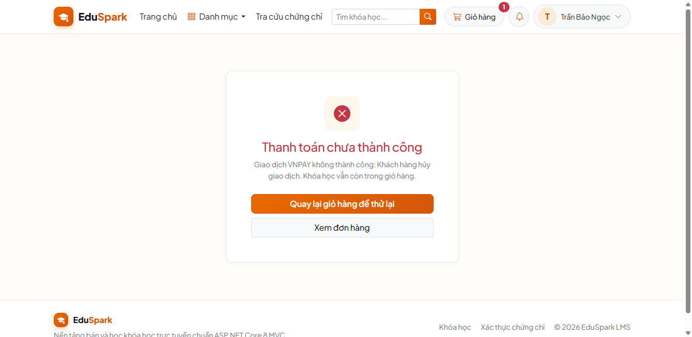
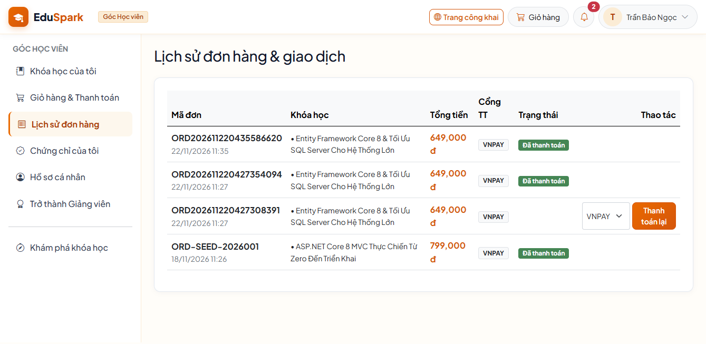
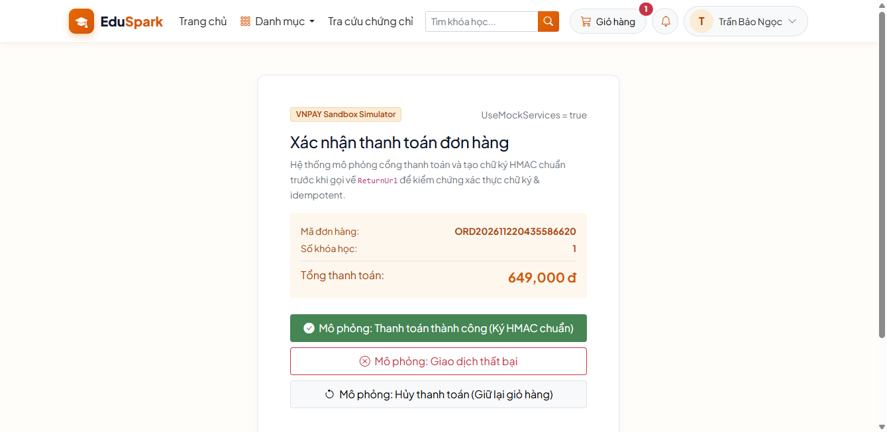

# Hướng dẫn thanh toán khóa học

Tài liệu dành cho **học viên** (cách mua khóa học) và **người kiểm thử** (thanh toán thử trên VNPAY Sandbox). Cấu hình kỹ thuật xem [DEPLOYMENT.md](DEPLOYMENT.md) và [VNPAY_INTEGRATION.md](VNPAY_INTEGRATION.md).

## 1. Mua khóa học

1. Đăng nhập tài khoản học viên.
2. Vào **Khóa học**, mở khóa học muốn mua, bấm **Thêm vào giỏ hàng**. Có thể thêm nhiều khóa học rồi thanh toán một lần.
3. Mở **Giỏ hàng** (góc trên bên phải), chọn cổng **VNPAY**, bấm **Tiến hành thanh toán**.
4. Hệ thống tạo đơn hàng ở trạng thái *Chờ thanh toán* và chuyển sang cổng VNPAY.

> Khóa học đã sở hữu sẽ tự bị loại khỏi đơn. Đơn có tổng tiền 0 đ được kích hoạt ngay, không qua VNPAY.

## 2. Thanh toán trên VNPAY

### 2.1. Chọn phương thức

| Phương thức | Mô tả |
|---|---|
| App Ngân hàng và Ví điện tử (VNPAY-QR) | Quét mã QR bằng app ngân hàng |
| Thẻ nội địa và tài khoản ngân hàng | Thẻ ATM / Internet Banking |
| Thẻ thanh toán quốc tế | Visa, MasterCard, JCB... |
| App VNPAY | Thanh toán trong ví VNPAY |

### 2.2. Thanh toán bằng thẻ test (Sandbox)

Trên môi trường thử nghiệm, chọn **Thẻ nội địa và tài khoản ngân hàng** → ngân hàng **NCB**, rồi nhập:

| Thông tin | Giá trị |
|---|---|
| Ngân hàng | NCB |
| Số thẻ | `9704198526191432198` |
| Tên chủ thẻ | `NGUYEN VAN A` |
| Ngày phát hành | `07/15` |
| Mật khẩu OTP | `123456` |

Trang VNPAY hiển thị số tiền, mã đơn hàng (`vnp_TxnRef`) và **đồng hồ đếm ngược 15 phút**; quá thời gian này giao dịch hết hạn (mã lỗi 11), cần thanh toán lại.

Bấm **Tiếp tục** → **Đồng ý & Tiếp tục** (điều khoản) → nhập OTP `123456` → **Thanh toán**.

> Thẻ trên chỉ dùng được ở Sandbox. Trên website thật, dùng thẻ/tài khoản ngân hàng của chính bạn; tiền bị trừ thật.

Có thể trải nghiệm trước cổng thanh toán tại trang demo của VNPAY: <https://sandbox.vnpayment.vn/apis/vnpay-demo/>.

## 3. Kết quả thanh toán

### Thành công

- Đơn hàng chuyển sang **Đã thanh toán**, khóa học xuất hiện ở **Khóa học của tôi**, giỏ hàng được xóa.
- Bạn nhận thông báo trên website và email xác nhận.

### Không thành công / hủy

- Trang kết quả hiển thị lý do (ví dụ "Khách hàng hủy giao dịch").
- Đơn chuyển sang **Đã hủy / Thất bại**, khóa học **vẫn còn trong giỏ hàng** để thử lại.

### Đang xác nhận

Nếu trang hiển thị **"Đang xác nhận thanh toán"**: VNPAY đã báo thành công nhưng hệ thống đang chờ thông báo IPN từ VNPAY. Đợi vài phút rồi bấm **Kiểm tra lại trạng thái**. Không thanh toán lại để tránh trừ tiền hai lần.

## 4. Thanh toán lại & lịch sử đơn hàng

Vào **Góc học viên → Lịch sử đơn hàng**:

- Đơn *Chờ thanh toán* hoặc *Đã hủy / Thất bại* có nút **Thanh toán lại**: chọn cổng rồi bấm để thanh toán tiếp cho chính đơn đó. Mỗi lần thanh toán lại, hệ thống sinh mã giao dịch VNPAY mới.
- Đơn *Đã thanh toán* không thể thanh toán lại.

## 5. Ý nghĩa mã lỗi VNPAY thường gặp

| Mã | Ý nghĩa | Nên làm |
|---|---|---|
| `00` | Thành công | Vào học |
| `07` | Trừ tiền thành công nhưng giao dịch bị nghi ngờ | Liên hệ hỗ trợ |
| `09` | Thẻ chưa đăng ký Internet Banking | Đăng ký với ngân hàng hoặc dùng thẻ khác |
| `10` | Xác thực thông tin thẻ sai quá 3 lần | Thử lại sau / dùng thẻ khác |
| `11` | Hết thời gian chờ thanh toán (15 phút) | Bấm **Thanh toán lại** |
| `12` | Thẻ/tài khoản bị khóa | Liên hệ ngân hàng |
| `13` | Sai OTP | Thanh toán lại, nhập đúng OTP |
| `24` | Bạn đã hủy giao dịch | Thanh toán lại khi sẵn sàng |
| `51` | Tài khoản không đủ số dư | Nạp thêm tiền / dùng thẻ khác |
| `65` | Vượt hạn mức giao dịch trong ngày | Thử lại hôm sau / dùng thẻ khác |
| `75` | Ngân hàng đang bảo trì | Thử lại sau |
| `79` | Sai mật khẩu thanh toán quá số lần quy định | Thử lại sau |
| `99` | Lỗi khác | Thử lại / liên hệ hỗ trợ |

## 6. Câu hỏi thường gặp

**Tiền đã bị trừ nhưng khóa học chưa mở?**
Đợi vài phút: VNPAY sẽ gửi lại thông báo IPN (tối đa 10 lần, mỗi lần cách 5 phút) và khóa học tự kích hoạt. Nếu sau 1 giờ vẫn chưa có, gửi cho quản trị viên **mã đơn hàng** và **mã giao dịch VNPAY** (trong SMS/email ngân hàng); quản trị viên đối soát trong bảng `Transactions`.

**Có bị trừ tiền hai lần khi bấm thanh toán lại?**
Không, nếu đơn trước chưa thanh toán thành công. Hệ thống xử lý mỗi đơn đúng một lần; callback lặp lại từ VNPAY không tạo thêm ghi danh.

**Muốn hoàn tiền?**
Liên hệ quản trị viên. Chức năng hoàn tiền tự động (API `refund` của VNPAY) chưa được tích hợp; quản trị viên thực hiện trên trang quản trị merchant của VNPAY.

## 7. Dành cho người kiểm thử: chế độ giả lập

Khi chạy ở máy dev với VNPAY giả lập (`AppFeatures:UseMockServices = true`, `Vnpay:UseRealGateway = false`), bấm thanh toán sẽ mở trang **VNPAY Sandbox Simulator** thay vì VNPAY thật:

| Nút | Mô phỏng |
|---|---|
| Thanh toán thành công | `vnp_ResponseCode = 00` |
| Giao dịch thất bại | `vnp_ResponseCode = 99` |
| Hủy thanh toán | `vnp_ResponseCode = 24` |

Trang giả lập ký callback bằng HMAC chuẩn, gọi xử lý IPN rồi chuyển về ReturnUrl như VNPAY thật. Trang này **tự tắt (404)** khi cổng VNPAY thật được bật.

Để kiểm thử với VNPAY Sandbox thật trên máy dev, xem [VNPAY_INTEGRATION.md](VNPAY_INTEGRATION.md) mục 3.
