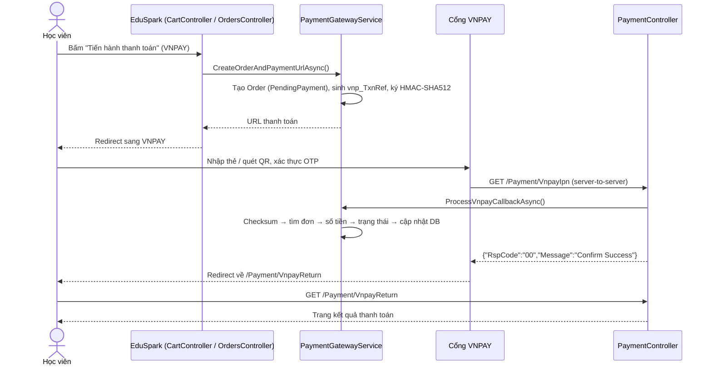

# Tích hợp thanh toán VNPAY (Cổng thanh toán PAY - API 2.1.0)

Tài liệu ghi lại các bước đã thực hiện để tích hợp VNPAY vào EduSpark, bám theo:

- Tài liệu online: <https://sandbox.vnpayment.vn/apis/docs/thanh-toan-pay/pay.html>
- Đặc tả kỹ thuật `QuanLiKhoaHocTrucTuyen/docs/VNPAY Payment Gateway_Techspec Post method 2.1.0-VN.pdf` (mục 2.5.3 `vnp_Command=pay`, 2.5.7 bảng mã lỗi).

> **Lưu ý về checksum:** code mẫu trong PDF (mục 2.5.8) ghép `hashData` từ giá trị *chưa* URL-encode, trong khi tài liệu online và thư viện C# hiện hành của VNPAY URL-encode giá trị trước khi băm. Sandbox hiện tại dùng cách thứ hai, nên EduSpark ký trên chuỗi query đã encode (`WebUtility.UrlEncode`, khoảng trắng thành `+`).

## 1. Luồng thanh toán



| Bước | Thành phần | Mô tả |
|---|---|---|
| Tạo URL thanh toán | `PaymentGatewayService.BuildVnpayUrl` | Sắp xếp tham số `vnp_*` theo tên tăng dần, URL-encode, ký `HMACSHA512(HashSecret)` rồi gắn `vnp_SecureHash`. |
| IPN URL | `PaymentController.VnpayIpn` | VNPAY gọi server-to-server. **Nơi cập nhật kết quả thanh toán vào DB.** |
| Return URL | `PaymentController.VnpayReturn` | Trình duyệt khách được chuyển về. Kiểm tra checksum và hiển thị kết quả. |

## 2. Các bước đã thực hiện

### Bước 1 - Cấu hình kết nối (`Options/AppOptions.cs`, `appsettings.json`)

`VnpayOptions` (section `Vnpay`):

| Khóa | Mặc định | Ý nghĩa |
|---|---|---|
| `TmnCode` | `EDUSPARK` | Mã website VNPAY cấp (`vnp_TmnCode`). |
| `HashSecret` | rỗng | Chuỗi bí mật ký checksum. **Chỉ đặt qua User Secrets / biến môi trường.** |
| `BaseUrl` | `https://sandbox.vnpayment.vn/paymentv2/vpcpay.html` | URL thanh toán (production đổi theo VNPAY cấp). |
| `ReturnPath` / `IpnPath` | `/Payment/VnpayReturn` / `/Payment/VnpayIpn` | Đường dẫn Return/IPN. |
| `UseRealGateway` | `false` | `true`: gọi VNPAY thật kể cả khi `AppFeatures:UseMockServices = true` (MoMo/Email/YouTube vẫn giả lập). |
| `ExpireMinutes` | `15` | Thời hạn thanh toán (`vnp_ExpireDate`). |
| `UpdateOrderOnReturn` | `true` | Cho ReturnUrl cập nhật đơn khi IPN chưa tới (cần cho localhost). Production nên đặt `false`. |

Khi dùng cổng thật mà thiếu `TmnCode`/`HashSecret`, hệ thống báo lỗi "Cổng VNPAY chưa được cấu hình" thay vì gửi URL ký sai sang VNPAY.

### Bước 2 - Tạo URL thanh toán (`vnp_Command=pay`)

Các tham số gửi sang VNPAY:

| Tham số | Giá trị |
|---|---|
| `vnp_Version` | `2.1.0` |
| `vnp_Command` | `pay` |
| `vnp_TmnCode` | `Vnpay:TmnCode` |
| `vnp_Amount` | `TotalAmount * 100` (khử phần thập phân) |
| `vnp_CreateDate` / `vnp_ExpireDate` | Giờ GMT+7, `yyyyMMddHHmmss`; hết hạn sau `ExpireMinutes` phút |
| `vnp_CurrCode` | `VND` |
| `vnp_IpAddr` | IP khách; `::1`/IPv4-mapped được chuẩn hóa về IPv4 (`NormalizeClientIp`) |
| `vnp_Locale` | `vn` |
| `vnp_OrderInfo` | `Thanh toan khoa hoc {OrderCode}` (không dấu, không ký tự đặc biệt) |
| `vnp_OrderType` | `other` |
| `vnp_ReturnUrl` | `{scheme}://{host}/Payment/VnpayReturn` |
| `vnp_TxnRef` | `Order.PaymentTxnRef` |

**`vnp_TxnRef` không được trùng trong ngày**, nên mỗi lần thanh toán (kể cả "Thanh toán lại") sinh mã mới = `OrderCode` (chỉ giữ chữ/số) + `HHmmss`, lưu vào cột mới `Orders.PaymentTxnRef` (migration `AddOrderPaymentTxnRef`). Callback tìm đơn theo `PaymentTxnRef` (hoặc `OrderCode` cho đơn cũ).

### Bước 3 - IPN URL (cập nhật kết quả)

`ProcessVnpayCallbackAsync` xử lý đúng thứ tự tài liệu yêu cầu, `VnpayIpn` trả JSON `RspCode`/`Message` (giữ nguyên tên khóa, không camelCase):

| Thứ tự kiểm tra | Kết quả | RspCode |
|---|---|---|
| 1. Checksum `vnp_SecureHash` (bỏ `vnp_SecureHash`, `vnp_SecureHashType`, sắp xếp, URL-encode, HMAC-SHA512) | Sai chữ ký | `97` |
| 2. Tìm đơn theo `vnp_TxnRef` | Không thấy | `01` |
| 3. So sánh `vnp_Amount` với `TotalAmount * 100` | Lệch | `04` |
| 4. Trạng thái đơn (đã `Paid`, hoặc đã `Cancelled` mà callback lại báo thất bại) | Đã xử lý | `02` |
| 5. `vnp_ResponseCode == "00"` **và** `vnp_TransactionStatus == "00"` → `Paid`, tạo `Enrollment`, xóa giỏ, gửi thông báo + email. Ngược lại → `Cancelled`, giữ giỏ hàng | Ghi nhận | `00` |
| Không có tham số / exception | Lỗi | `99` |

VNPAY dừng gọi lại khi nhận `00` hoặc `02`; các mã khác (hoặc timeout) sẽ được VNPAY retry tối đa 10 lần, mỗi lần cách 5 phút. Mọi callback đều được lưu vào bảng `Transactions` (kèm `RawPayload`, `SignatureValid`) để đối soát.

### Bước 4 - Return URL (hiển thị kết quả)

- Kiểm tra checksum, hiển thị thành công / thất bại kèm lý do theo bảng mã `vnp_ResponseCode` (ví dụ `24` → "Khách hàng hủy giao dịch").
- Khi `UpdateOrderOnReturn = false`: **không ghi DB** (đúng khuyến nghị VNPAY). Nếu IPN chưa tới, trang hiển thị "Đang xác nhận thanh toán" với nút kiểm tra lại (`/Payment/Result?orderCode=...`).
- Khi `UpdateOrderOnReturn = true` (mặc định cho dev): nếu IPN chưa tới thì Return cập nhật đơn; xử lý idempotent nên IPN đến sau sẽ nhận `02`.

### Bước 5 - Chế độ giả lập (mock)

Khi `UseMockServices = true` và `UseRealGateway = false`, checkout chuyển tới `/Payment/MockGateway`. Trang này ký callback bằng HMAC chuẩn, **gọi xử lý IPN trước** rồi redirect về ReturnUrl, mô phỏng đúng thứ tự của VNPAY. Nếu `HashSecret` để trống, mock dùng secret demo nội bộ (trước đây secret rỗng khiến mọi callback mock bị từ chối vì sai chữ ký).

### Bước 6 - Kiểm thử

`QuanLiKhoaHocTrucTuyen.Tests/VnpayIntegrationTests.cs` bao gồm: URL có `vnp_ExpireDate` và chữ ký hợp lệ, `vnp_TxnRef` chỉ chữ/số và khác nhau giữa các lần thử, chuẩn hóa IP, thiếu cấu hình, các nhánh `01/02/04/97`, `ResponseCode=00` nhưng `TransactionStatus≠00`, khách hủy (`24`), ReturnUrl không ghi DB.

```bash
DOTNET_ROLL_FORWARD=Major dotnet test QuanLiKhoaHocTrucTuyen.slnx
```

## 3. Chạy với VNPAY Sandbox thật

1. Đăng ký tài khoản test tại <https://pay.vnpaytest.vn/dev-registration> → nhận `vnp_TmnCode` và `vnp_HashSecret` qua email.
2. Cấu hình bí mật (trong thư mục `QuanLiKhoaHocTrucTuyen`):
   ```bash
   dotnet user-secrets set "Vnpay:TmnCode" "<TMN_CODE>"
   dotnet user-secrets set "Vnpay:HashSecret" "<HASH_SECRET>"
   dotnet user-secrets set "Vnpay:UseRealGateway" "true"
   ```
   Nếu đã lưu thông tin VNPAY gửi trong file `QuanLiKhoaHocTrucTuyen/.env` (`vnp_TmnCode`, `vnp_HashSecret`, `vnp_Url`; file này đã nằm trong `.gitignore`), có thể nạp một lần bằng Git Bash:
   ```bash
   set -a && . ./.env && set +a
   dotnet user-secrets set "Vnpay:TmnCode" "$vnp_TmnCode"
   dotnet user-secrets set "Vnpay:HashSecret" "$vnp_HashSecret"
   dotnet user-secrets set "Vnpay:BaseUrl" "$vnp_Url"
   dotnet user-secrets set "Vnpay:UseRealGateway" "true"
   ```
3. Chạy ứng dụng, thêm khóa học vào giỏ, chọn **VNPAY** → được chuyển sang trang sandbox VNPAY.
4. Thẻ test (ngân hàng NCB):

   | Thông tin | Giá trị |
   |---|---|
   | Số thẻ | `9704198526191432198` |
   | Tên chủ thẻ | `NGUYEN VAN A` |
   | Ngày phát hành | `07/15` |
   | Mật khẩu OTP | `123456` |

5. **IPN trên localhost:** VNPAY không gọi được `localhost`. Để test IPN, public ứng dụng qua tunnel (ví dụ `ngrok http 5152` hoặc Dev Tunnels của Visual Studio) và khai báo IPN URL `https://<tunnel>/Payment/VnpayIpn` tại trang quản trị merchant sandbox (<https://sandbox.vnpayment.vn/merchantv2/>). Nếu chưa cấu hình IPN, giữ `UpdateOrderOnReturn = true` để Return URL cập nhật đơn.

## 4. Lưu ý khi lên production

- Đổi `BaseUrl` sang URL production và dùng `TmnCode`/`HashSecret` production (không commit vào git).
- Đặt `Vnpay:UpdateOrderOnReturn = false` để chỉ IPN cập nhật kết quả.
- IPN URL bắt buộc HTTPS và phải khai báo với VNPAY.
- Nếu chạy sau reverse proxy, cấu hình `ForwardedHeaders` để `vnp_IpAddr` và `vnp_ReturnUrl` lấy đúng IP/scheme/host thật.
- Chưa gửi các tham số tùy chọn `vnp_Bill_*` / `vnp_Inv_*` (thông tin hóa đơn) và `vnp_BankCode` (khách chọn phương thức tại trang VNPAY).
- Chưa tích hợp API truy vấn (`querydr`), hoàn tiền (`refund`, `refundbatch`) - các API này dùng POST JSON với checksum dạng chuỗi nối `|` (PDF mục 2.5.4 - 2.5.6) tại `https://sandbox.vnpayment.vn/merchant_webapi/api/transaction`; có thể bổ sung để đối soát các đơn còn `PendingPayment`.
